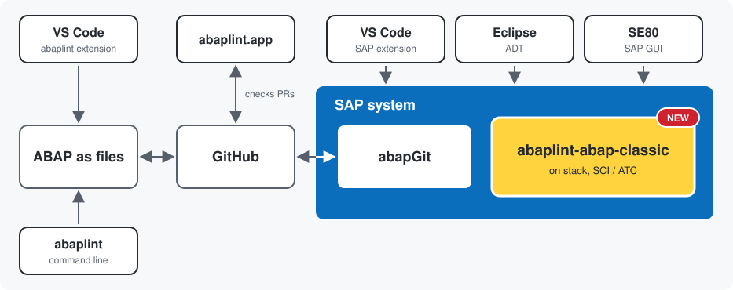

# abaplint as Classic ABAP on stack

BETA RELEASE

abaplint for classic ABAP code inspector/ATC

Install via [abapGit](https://github.com/abapgit/abapgit), its a lot of code so it will take some time to pull, and enable the checks via `SCI` transaction.

Currently only default configurations are supported, things will change so only use it for experimental purposes.

## abaplint.app

Looking for a hosted setup? [abaplint.app](https://abaplint.app) runs abaplint automatically on your GitHub pull requests: no system installation, custom configurations supported, and findings reported right where you review code.